# Comprehensive Codebase Audit: Backend, HTML Templates, Client-Side JavaScript & Deprecation Strategy

## Executive Summary
This report presents a thorough, full-stack codebase audit of `kb-web` on the `feature/taxonomic-fact-extraction-mesh` branch. The audit encompasses backend Python services, data access layers, Jinja2 HTML templates (`src/kb_web/templates/`), client-side JavaScript (`src/kb_web/static/js/jinja_highlighter.js`), and inline frontend controllers.

An interactive, dark-mode glassmorphic HTML report featuring filterable severity cards, dynamic metrics, and copy-ready GitHub issue definitions has been generated at:
👉 [audit_report.html](file:///c:/src/kb-web/.artifacts/feature-taxonomic-fact-extraction-mesh/audit_report.html)

---

## 1. Critical & High Priority Findings

### 🔴 [SEC-02] Stored XSS in Global Layout Notifications Dropdown & Toasts
- **File & Location**: [`src/kb_web/templates/base.j2.html:732, 770`](file:///c:/src/kb-web/src/kb_web/templates/base.j2.html#L732)
- **Root Cause**:
  In `base.j2.html`, which is inherited across all views in the entire application, the notification fetcher executes:
  ```javascript
  html += '<p class="notif-msg text-gray-700 mt-0.5 break-words text-xs">' + (n.message || '') + '</p>';
  list.innerHTML = html;
  ```
  and inside `showToastNotification`:
  ```javascript
  toast.innerHTML = '<span class="text-lg">' + icon + '</span><div class="flex-grow min-w-0"><div class="font-bold text-gray-950 dark:text-gray-100">' + (stage || 'Update') + '</div><div class="text-gray-650 dark:text-gray-300 mt-0.5 break-words">' + message + linkHtml + '</div></div><button onclick="this.parentElement.remove()" class="text-gray-400 hover:text-gray-600 font-bold ml-1">✕</button>';
  ```
- **Impact**: Any ingested page title, crawler error, or background agent observation containing HTML tags or JavaScript payloads (``, `<script>...`) achieves Stored Cross-Site Scripting (XSS) in the context of the user's or administrator's browser session across all pages.
- **Remediation**:
  Define an `escapeHtml()` utility within `base.j2.html` and sanitize `n.message` and `message` before assigning to `innerHTML`, or set `textContent` / `innerText` on child nodes.

---

### 🔴 [SEC-03] Stored XSS in Autonomous Agent Wikis & Themed Canvas Pages
- **File & Location**: [`src/kb_web/routers/agent_pages.py:107-113, 174-180`](file:///c:/src/kb-web/src/kb_web/routers/agent_pages.py#L107-L113), [`src/kb_web/templates/topic_wiki_page.j2.html:68`](file:///c:/src/kb-web/src/kb_web/templates/topic_wiki_page.j2.html#L68), [`src/kb_web/templates/agent_page_themed.j2.html:34`](file:///c:/src/kb-web/src/kb_web/templates/agent_page_themed.j2.html#L34)
- **Root Cause**:
  In `agent_pages.py`, agent wiki articles and themed canvas pages render markdown via:
  ```python
  rendered_body = markdown.markdown(
      page.body_markdown or "",
      extensions=["fenced_code", "tables", "nl2br", "toc"],
  )
  ```
  and pass it directly to `topic_wiki_page.j2.html` and `agent_page_themed.j2.html` where it is rendered with `{{ rendered_body | safe }}`. Unlike `src/kb_web/routers/pages.py`, no call to `sanitize_html()` or `nh3.clean()` is made.
- **Impact**: An autonomous topic agent or imported article note containing malicious markdown or raw HTML elements executes arbitrary scripts whenever a visitor or administrator inspects the living wiki or themed page.
- **Remediation**:
  Wrap `rendered_body` in `sanitize_html(rendered_body)` before template rendering.

---

### 🔴 [BUG-01] Vector Embedding Indexer Indefinitely Loops on Oldest Single Page
- **File & Location**: [`src/kb_web/worker.py:452-462`](file:///c:/src/kb-web/src/kb_web/worker.py#L452-L462)
- **Root Cause**:
  ```python
  with db_session() as session:
      # Pick the oldest page lacking description or chunk embeddings
      row = (
          session.query(FetchedPage)
          .order_by(FetchedPage.fetched_at.asc())
          .first()
      )
  ```
  The query comment states "Pick the oldest page lacking description or chunk embeddings", but contains **no filter condition**.
- **Impact**: Every 15 minutes when `_run_embedding_refresh` executes, it picks the exact same oldest page in `fetched_pages` and re-indexes it. Newer pages imported into the system are never processed by the background indexer.
- **Remediation**:
  ```python
  subq = select(ChunkEmbedding.source_id).where(ChunkEmbedding.model_name == job.model)
  row = (
      session.query(FetchedPage)
      .filter(FetchedPage.url.not_in(subq))
      .order_by(FetchedPage.fetched_at.asc())
      .first()
  )
  ```

---

### 🔴 [SEC-01] Unescaped Raw f-Strings in Dynamic Prompt Version Queries
- **File & Location**: [`src/kb_web/config.py:719-726`](file:///c:/src/kb-web/src/kb_web/config.py#L719-L726)
- **Root Cause**:
  ```python
  db.execute_returning_dicts(
      f"SELECT MAX(version) as mv FROM agent_prompts WHERE prompt_type = '{prompt_type}'"
  )
  db.execute(
      f"UPDATE agent_prompts SET is_head = 0 WHERE prompt_type = '{prompt_type}'"
  )
  ```
- **Impact**: Bypasses SQL parameterized bindings. If `prompt_type` contains single quotes or user input, it causes SQL parsing errors or introduces SQL injection vulnerabilities.
- **Remediation**: Use parameterized bindings:
  ```python
  db.execute("UPDATE agent_prompts SET is_head = 0 WHERE prompt_type = ?", [prompt_type])
  ```

---

## 2. Frontend & Template Logical Errors

### 🟡 [BUG-02] Workspace IDE Folder Deletion Flaw & N-Network Flooding
- **File & Location**: [`src/kb_web/templates/workspace_ide.j2.html:1201-1209`](file:///c:/src/kb-web/src/kb_web/templates/workspace_ide.j2.html#L1201-L1209)
- **Root Cause**:
  When a user deletes a folder in the Workspace IDE, client JS executes:
  ```javascript
  for (const p of toDelete) {
    VFS.deleteFile(p);
    closeTab(p);
    await fetch(`/api/workspaces/${WORKSPACE_ID}/files`, {
      method: "DELETE",
      headers: { "Content-Type": "application/json" },
      body: JSON.stringify({ path: p }),
    });
  }
  ```
  Meanwhile, the backend endpoint `DELETE /api/workspaces/{workspace_id}/files` in `src/kb_web/routers/workspaces.py:909-921` **already handles folder prefixes atomically**.
- **Impact**: Deleting a folder with 50 files fires 50 sequential HTTP requests. If network latency is high or a single request fails, the folder is left in a partially deleted, desynchronized state between the client and server.
- **Remediation**: Replace the client-side loop with a single atomic deletion call passing `folderPath`.

---

### 🟡 [BUG-03] Jinja Highlighter Event Leak, Missing Teardown & Filter Syntax Limitation
- **File & Location**: [`src/kb_web/static/js/jinja_highlighter.js:98-105, 260`](file:///c:/src/kb-web/src/kb_web/static/js/jinja_highlighter.js#L98-L105)
- **Root Cause**:
  1. Every instance binds `window.addEventListener('resize', ...)` and `ResizeObserver` without providing a `destroy()` or `disconnect()` method. When editor dialogs or tab views re-render, listeners accumulate, leaking memory.
  2. The parameter detection regex `const regex = /\{\{\s*([a-zA-Z0-9_.]+)\s*\}\}/g;` only allows alphanumeric characters and dots. If a prompt uses standard Jinja filter expressions like `{{ data.title | default('None') }}` or `{{ data.tags | join(', ') }}`, the regex fails to match or misidentifies the field as invalid.
- **Remediation**:
  1. Add a `destroy()` method that removes the window resize listener and disconnects `this.resizeObserver`.
  2. Update regex to accommodate Jinja filters: `/\{\{\s*([a-zA-Z0-9_.]+)(?:\s*\|[^}]+)?\s*\}\}/g`.

---

### 🟡 [BUG-04] Admin Portal Highlighter Script Ordering Race Condition
- **File & Location**: [`src/kb_web/templates/admin.j2.html:1660, 2647`](file:///c:/src/kb-web/src/kb_web/templates/admin.j2.html#L1660)
- **Root Cause**:
  In `admin.j2.html`, `initJinjaHighlighter` is called within a `DOMContentLoaded` listener at line 1660, but the external script tag `<script src="/static/js/jinja_highlighter.js"></script>` is located at line 2647 at the very bottom of the template block. In certain browsers or cached states, `DOMContentLoaded` fires before the script has finished executing, leaving `window.initJinjaHighlighter` undefined.
- **Remediation**:
  Move `<script src="/static/js/jinja_highlighter.js"></script>` to the `extra_head` block or before the main inline script block, consistent with `evals.j2.html`.

---

### 🟡 [SEC-04] DOM XSS & Attribute Breakout via Unescaped URLs in Event Handlers
- **File & Location**: [`src/kb_web/templates/view_collection.j2.html:338, 366`](file:///c:/src/kb-web/src/kb_web/templates/view_collection.j2.html#L338), [`src/kb_web/templates/collection_editor.j2.html:422`](file:///c:/src/kb-web/src/kb_web/templates/collection_editor.j2.html#L422), [`src/kb_web/templates/url_import.j2.html:599`](file:///c:/src/kb-web/src/kb_web/templates/url_import.j2.html#L599)
- **Root Cause**:
  Item URLs are concatenated directly into JavaScript event strings (e.g. `onclick="removeSingleItem('${item.url}')"`) and unquoted/unescaped attributes.
- **Impact**: Single quotes in item URLs break JS execution or allow attribute breakout and XSS.
- **Remediation**: Pass URLs via data attributes (`data-url`) and attach listeners unobtrusively, or escape quotes with `escapeHtml()`.

---

## 3. Performance & Resource Bottlenecks

### 🟡 [PERF-01] Startup Ghost Stub Purge Runs 10 Queries Per Row in Loop
- **File & Location**: [`src/kb_web/models_orm.py:867-884`](file:///c:/src/kb-web/src/kb_web/models_orm.py#L867-L884)
- **Root Cause**:
  On every server boot inside `ensure_views_and_indexes()`, the server executes:
  ```python
  ghost_urls = conn.execute(text("""SELECT url FROM fetched_pages WHERE title LIKE 'Archived Item (%%' ...""")).fetchall()
  for (g_url,) in ghost_urls:
      conn.execute(text("DELETE FROM article_embeddings WHERE url = :u"), {"u": g_url})
      conn.execute(text("DELETE FROM title_embeddings WHERE url = :u"), {"u": g_url})
      ... (10 sequential queries)
  ```
- **Impact**: Multiplies startup latency by running N * 10 unbatched round-trips to the database on every process launch.
- **Remediation**: Execute a single set-based cascade delete query or migrate to a one-time Alembic migration script.

---

### 🟡 [PERF-02] Vault Zip Unpacker Opens Individual DB Session Per Note and Overwhelms Ollama
- **File & Location**: [`src/kb_web/routers/notes.py:385-411`](file:///c:/src/kb-web/src/kb_web/routers/notes.py#L385-L411)
- **Root Cause**:
  During zip extraction, every single `.md` file opens a new `with db_session() as session:`, executes a `commit()`, and immediately adds `_process_note_in_background` to FastAPI `background_tasks`.
- **Impact**: Importing a 2,000-note vault causes 2,000 individual database transactions, followed by 2,000 concurrent background workers hitting Ollama simultaneously, resulting in CPU starvation and Ollama timeouts.
- **Remediation**: Batch insertions into a single transaction, and delegate background curation to the asynchronous worker job queue.

---

### 🟡 [PERF-03] Unbounded In-Memory Scan of All Note Records During Taxonomy Classification
- **File & Location**: [`src/kb_web/routers/taxonomy.py:175-180`](file:///c:/src/kb-web/src/kb_web/routers/taxonomy.py#L175-L180)
- **Root Cause**:
  `trigger_classify_notes` executes `all_matching = query.all()` and then filters notes in Python using a list comprehension against classified IDs.
- **Impact**: On large vaults, loading all ORM notes into RAM causes memory spikes and GC stalls.
- **Remediation**: Perform the exclusion at the SQL level using `NOT IN` or a `LEFT JOIN`.

---

## 4. Components to Phase Out & Deprecate

### 🟡 [DEPR-01] Legacy 10-Item Partitioning Category Taxonomy State Machine
- **File & Location**: [`src/kb_web/taxonomy_state_machine.py:1-1289`](file:///c:/src/kb-web/src/kb_web/taxonomy_state_machine.py#L1-L1289) and `TaxonomyCategory` / `TaxonomyItem` in [`models_orm.py`](file:///c:/src/kb-web/src/kb_web/models_orm.py)
- **Why It Needs to be Phased Out**:
  1. **Global Contention**: The 10-item partitioning loop acquires `_taxonomy_lock` and sets `_partitioning_paused = True`, halting additions across the entire application while items are dynamically partitioned.
  2. **Taxonomy Thrashing**: Dynamic categories constantly change slugs and merge/split, causing unstable URLs.
  3. **Architectural Redundancy**: Directly conflicts with the principled 7-tier biological taxonomy (`Kingdom -> Phylum -> Class -> Order -> Family -> Genus -> Species`) and `ContextMesh` implemented in `src/kb_web/taxonomy/` and `src/kb_web/context_mesh/`.
- **Phase-Out Plan**:
  - Deprecate `src/kb_web/taxonomy_state_machine.py`.
  - Re-route `/taxonomy` and `/api/taxonomy/*` to query `TaxonomyEngine` and `taxonomy_entities`.
  - Migrate legacy category items into 7-tier canonical paths.

---

### 🟡 [DEPR-02] Embedding Table Fragmentation (`article_embeddings`, `title_embeddings`, `video_embeddings`)
- **File & Location**: [`src/kb_web/models_orm.py:114-128, 217-224`](file:///c:/src/kb-web/src/kb_web/models_orm.py#L114-L128)
- **Why It Needs to be Phased Out**:
  The schema currently maintains:
  - `article_embeddings` (single vector per page)
  - `title_embeddings` (single vector per title)
  - `video_embeddings` (single vector per YouTube video)
  - `chunk_embeddings` (multi-chunk vectors with chunk offsets, content text, model name, and metadata)
  - `context_statements.statement_vector` (atomic declarative statement vectors)
- **Phase-Out Plan**:
  Consolidate document-level search onto `chunk_embeddings` and `context_statements`, deprecating the 3 redundant single-vector tables.

---

### 🟡 [DEPR-03] Direct `sqlite_utils` Dependency in PostgreSQL Architecture
- **File & Location**: [`src/kb_web/db.py:18-26`](file:///c:/src/kb-web/src/kb_web/db.py#L18-L26) and `pyproject.toml:22`
- **Why It Needs to be Phased Out**:
  The project is explicitly moving to PostgreSQL (`Note: SQLite is being phased out in favor of PostgreSQL` from GEMINI.md). `src/kb_web/db.py:18` still initializes a raw `sqlite_utils.Database` instance in `get_db()`.
- **Phase-Out Plan**:
  Deprecate `get_db()`, migrate remaining CLI callers to standard SQLAlchemy `db_session()`, and remove `sqlite-utils` from `pyproject.toml`.

---

## 5. Code Quality & Linter Deprecations

| Issue ID | Category | Location | Summary & Recommendation |
| :--- | :--- | :--- | :--- |
| **CONF-01** | Config | `models_orm.py:7` | **SQLAlchemy 2.0 Warning**: `declarative_base()` imported from `sqlalchemy.ext.declarative` instead of `sqlalchemy.orm`. |
| **ARCH-01** | Architecture | `db.py:78-112`, `models_orm.py:903` | **Magic Number Assumption**: Hardcoded assumption that `collection_id = 1` is always "General Collection". |
| **CODE-01** | Quality | Multiple (95 files) | **Naive Datetime**: 95 occurrences of `datetime.now()` without `timezone.utc`, risking timestamp drift. |
| **CODE-02** | Reliability | Multiple (93 files) | **Silent Exception Swallowing**: 93 occurrences of `except Exception: pass` without debug logging. |

---

## 6. Prioritized Remediation Roadmap

```mermaid
graph TD
    A["Phase A: Critical Security & Immediate Fixes"] --> A1["SEC-02: Escape notification messages in base.j2.html"]
    A --> A2["SEC-03: Add sanitize_html() to agent_pages.py wiki & themed canvas"]
    A --> A3["BUG-01: Fix worker.py embedding refresh missing chunk filter"]
    A --> A4["SEC-01: Parameterize config.py prompt version SQL queries"]

    B["Phase B: UI & Frontend Hardening"] --> B1["BUG-02: Workspace IDE atomic folder prefix deletion"]
    B --> B2["BUG-03: Jinja Highlighter lifecycle destroy() & filter regex"]
    B --> B3["BUG-04: Admin portal highlighter script load ordering"]
    B --> B4["SEC-04: Escape URLs in event handlers & data attributes"]

    C["Phase C: Deprecations & Architectural Consolidation"] --> C1["DEPR-01: Deprecate taxonomy_state_machine.py in favor of 7-tier biological taxonomy"]
    C --> C2["DEPR-02: Consolidate article/title/video embedding tables into chunk_embeddings"]
    C --> C3["DEPR-03: Phase out sqlite_utils in favor of SQLAlchemy db_session()"]

    D["Phase D: Performance Optimization & Hygiene"] --> D1["PERF-01: Batch startup ghost stub deletion into single query"]
    D --> D2["PERF-02: Batch note vault unpacker transactions"]
    D --> D3["PERF-03: SQL-level note exclusion in taxonomy crawler"]
```


