# Database Architecture & Schema Specification

This document provides a comprehensive technical specification of the `kb-web` PostgreSQL relational schema, including pgvector vector embeddings, JSONB metadata structures, and the high-throughput `vw_page_cards` materialized view.

---

## 1. Engine & Extension Standards

- **Primary Database Engine**: PostgreSQL 15+
- **Vector Search Extension**: `pgvector` (`CREATE EXTENSION IF NOT EXISTS vector;`)
- **Character Encoding**: `UTF8`
- **Timezone Invariant**: All timestamps are stored in UTC (`TIMESTAMP WITHOUT TIME ZONE` or `TIMESTAMP WITH TIME ZONE` explicitly cast via `datetime.now(timezone.utc)`).
- **Primary Keys**: Auto-incrementing 64-bit BigInt (`BIGSERIAL` / `Integer`) or natural string identifiers (`url`, `agent_id`, `node_id`).

---

## 2. Entity-Relationship Model Overview

```mermaid
erDiagram
    FETCHED_PAGES ||--o{ PAGE_VERSIONS : has
    FETCHED_PAGES ||--o{ WIKI_VERSIONS : has
    FETCHED_PAGES ||--o| ARTICLE_EMBEDDINGS : has
    FETCHED_PAGES ||--o| TITLE_EMBEDDINGS : has
    FETCHED_PAGES ||--o{ CHUNK_EMBEDDINGS : chunks
    FETCHED_PAGES ||--o{ CONTEXT_STATEMENTS : extracts
    FETCHED_PAGES ||--o{ TAXONOMY_ENTITIES : extracts
    COLLECTIONS ||--o{ COLLECTION_ITEMS : contains
    COLLECTIONS ||--o{ COLLECTION_NOTES : annotates
    WORKSPACES ||--o{ WORKSPACE_FILES : contains
    WORKSPACES ||--o{ WORKSPACE_SNAPSHOTS : snapshots
    CUSTOM_AGENTS ||--o{ TOPIC_WIKI_PAGES : authors
    CUSTOM_AGENTS ||--o{ AGENT_PAGES : renders
    CUSTOM_AGENTS ||--o{ AGENT_OBSERVATIONS : records
    CUSTOM_AGENTS ||--o{ AGENT_SELF_TASKS : executes
    CUSTOM_AGENTS ||--o{ AGENT_PYTHON_APPROVALS : gates
```



---

## 3. Subsystem Table Schemas

### Subsystem 1: Core Web Ingestion & Content

#### `fetched_pages`
The root storage entity for every ingested URL (web page, documentation article, or blog post).
- `url` (`VARCHAR(2048)`, PRIMARY KEY): Canonical URL of the ingested page.
- `title` (`TEXT`): Extracted HTML `<title>` or OpenGraph title.
- `cleaned_content` (`TEXT`): Distilled, boilerplate-stripped Markdown text.
- `raw_html` (`TEXT`, NULLABLE): Raw unmodified source HTML.
- `fetched_at` (`TIMESTAMP`): Ingestion timestamp.
- `etag` (`VARCHAR(255)`, NULLABLE): HTTP ETag header for change detection.
- `last_modified` (`VARCHAR(255)`, NULLABLE): HTTP Last-Modified header.
- `status_code` (`INTEGER`): HTTP response status code (e.g., 200).
- `content_hash` (`VARCHAR(64)`): SHA-256 hash of `cleaned_content`.
- `content_length` (`INTEGER`): Character length of `cleaned_content`.
- `ai_wiki` (`TEXT`, NULLABLE): Autonomous LLM-generated comprehensive summary and key takeaways.
- `tags` (`JSONB` / `TEXT`): JSON array of assigned topic tags.
- `tax_kingdom` (`VARCHAR(255)`, NULLABLE): Level 1 steered topic node coordinate.
- `tax_phylum` (`VARCHAR(255)`, NULLABLE): Level 2 steered topic node coordinate.
- `tax_class` (`VARCHAR(255)`, NULLABLE): Level 3 steered topic node coordinate.
- `tax_order` (`VARCHAR(255)`, NULLABLE): Source domain / collection coordinate.
- `tax_family` (`VARCHAR(255)`, NULLABLE): Sub-collection / category coordinate.
- `tax_genus` (`VARCHAR(255)`, NULLABLE): Specific item group coordinate.
- `tax_species` (`VARCHAR(255)`, NULLABLE): Unique coordinate leaf identifier.
- `is_frozen` (`BOOLEAN`, DEFAULT `FALSE`): When true, worker auto-curation and taxonomy re-sorting ignore this item.
- `auto_refetch` (`BOOLEAN`, DEFAULT `FALSE`): When true, background worker periodically checks and refetches this URL.
- `refetch_interval_hours` (`INTEGER`, DEFAULT 168): Polling cadence in hours when `auto_refetch` is active.
- `last_refetched_at` (`TIMESTAMP`, NULLABLE): Last time an automated re-fetch was executed.

#### `page_versions`
Audit log of raw HTML and markdown content versions across time.
- `id` (`BIGSERIAL`, PRIMARY KEY)
- `url` (`VARCHAR(2048)`, FOREIGN KEY -> `fetched_pages.url` ON DELETE CASCADE)
- `content` (`TEXT`): Full text of that version.
- `content_hash` (`VARCHAR(64)`): SHA-256 digest.
- `version_num` (`INTEGER`): Sequential version index.
- `created_at` (`TIMESTAMP`): Version capture timestamp.

#### `wiki_versions`
Historical revisions of AI-generated Wiki summaries.
- `id` (`BIGSERIAL`, PRIMARY KEY)
- `url` (`VARCHAR(2048)`, FOREIGN KEY -> `fetched_pages.url` ON DELETE CASCADE)
- `ai_wiki` (`TEXT`): Wiki markdown content.
- `model_used` (`VARCHAR(255)`): LLM model name used for generation.
- `created_at` (`TIMESTAMP`): Creation timestamp.

#### `site_wikis`
Domain-level synthesis documents summarizing an entire site or domain.
- `domain` (`VARCHAR(255)`, PRIMARY KEY): Domain name (e.g., `docs.python.org`).
- `wiki_content` (`TEXT`): Synthesized domain knowledge.
- `page_count` (`INTEGER`): Number of pages belonging to this domain.
- `updated_at` (`TIMESTAMP`): Timestamp of last synthesis.

#### `youtube_videos`
Specialized video ingestion entity extracted via `yt-dlp`.
- `video_id` (`VARCHAR(64)`, PRIMARY KEY): YouTube 11-char ID or provider key.
- `url` (`VARCHAR(2048)`): Full YouTube URL.
- `title` (`TEXT`): Video title.
- `description` (`TEXT`): Video description.
- `channel` (`VARCHAR(255)`): Channel name.
- `channel_id` (`VARCHAR(255)`): Channel ID.
- `duration` (`INTEGER`): Video duration in seconds.
- `view_count` (`BIGINT`): Ingested view count.
- `upload_date` (`VARCHAR(32)`): Upload date string.
- `transcript` (`TEXT`, NULLABLE): Full auto-generated or manual subtitle transcript.
- `ai_summary` (`TEXT`, NULLABLE): LLM synthesized video summary.
- `tags` (`JSONB` / `TEXT`): JSON array of tags.
- `fetched_at` (`TIMESTAMP`): Extraction timestamp.

#### `notes`
User-authored Markdown notes linked across the knowledge base.
- `id` (`BIGSERIAL`, PRIMARY KEY)
- `title` (`TEXT`): Note title.
- `content` (`TEXT`): Note markdown content.
- `url` (`VARCHAR(2048)`, NULLABLE): Optional URL reference.
- `tags` (`JSONB` / `TEXT`): Array of tags.
- `tax_path` (`VARCHAR(1024)`, NULLABLE): Knowledge tree folder coordinate.
- `created_at` (`TIMESTAMP`)
- `updated_at` (`TIMESTAMP`)

---

### Subsystem 2: Vector Embeddings (`pgvector`)

Vector embeddings are indexed using `SafeVector` (supporting dimension-flexible pgvector columns).

#### `article_embeddings`
- `url` (`VARCHAR(2048)`, PRIMARY KEY, FOREIGN KEY -> `fetched_pages.url` ON DELETE CASCADE)
- `embedding` (`vector(768)`): Full-article pooled embedding.
- `model` (`VARCHAR(128)`): Model name (e.g. `embeddinggemma:latest`).
- `created_at` (`TIMESTAMP`)

#### `title_embeddings`
- `url` (`VARCHAR(2048)`, PRIMARY KEY, FOREIGN KEY -> `fetched_pages.url` ON DELETE CASCADE)
- `embedding` (`vector(768)`): Embeddings of article titles for rapid title similarity match.
- `model` (`VARCHAR(128)`)
- `created_at` (`TIMESTAMP`)

#### `chunk_embeddings`
Sub-document semantic chunks for precision RAG retrieval.
- `id` (`BIGSERIAL`, PRIMARY KEY)
- `url` (`VARCHAR(2048)`, FOREIGN KEY -> `fetched_pages.url` ON DELETE CASCADE)
- `chunk_index` (`INTEGER`): Offset order within article.
- `chunk_text` (`TEXT`): 300-800 character passage.
- `embedding` (`vector(768)`): Chunk dense vector representation.
- `model` (`VARCHAR(128)`)
- `created_at` (`TIMESTAMP`)

#### `video_embeddings`
- `video_id` (`VARCHAR(64)`, PRIMARY KEY, FOREIGN KEY -> `youtube_videos.video_id` ON DELETE CASCADE)
- `embedding` (`vector(768)`)
- `model` (`VARCHAR(128)`)
- `created_at` (`TIMESTAMP`)

---

### Subsystem 3: Steered Knowledge Tree & Context Mesh

#### `taxonomy_topics` (`TopicGovernanceORM`)
Governance authority and folder tree definitions.
- `id` (`BIGSERIAL`, PRIMARY KEY)
- `name` (`VARCHAR(255)`, UNIQUE, NOT NULL): Topic or folder display label.
- `level` (`VARCHAR(64)`, DEFAULT `'topic'`): Node category (`topic`, `sub_topic`, `folder`).
- `status` (`VARCHAR(32)`, DEFAULT `'allowed'`): Governance status (`allowed`, `denied`).
- `parent_path` (`VARCHAR(1024)`, NULLABLE): Full hierarchical path of parent folder.
- `gating_criteria` (`TEXT`, NULLABLE): Natural-language decision instructions for decision models.
- `domain_blacklist` (`JSONB`, NULLABLE): Array of forbidden domains for this node.
- `is_frozen` (`BOOLEAN`, DEFAULT `FALSE`): When true, children cannot be automatically modified.
- `auto_refetch` (`BOOLEAN`, DEFAULT `FALSE`): When true, assigned items inherit auto-refetch.
- `refetch_interval_hours` (`INTEGER`, DEFAULT 168)
- `created_at` (`TIMESTAMP`)
- `updated_at` (`TIMESTAMP`)

#### `context_statements` (`ContextStatementORM`)
Atomic declarative facts, invariants, affordances, and intents extracted by LLM from ingested pages.
- `id` (`BIGSERIAL`, PRIMARY KEY)
- `statement` (`VARCHAR(2000)`, NOT NULL): Concise atomic fact (strictly condensed to <= 144 chars).
- `statement_type` (`VARCHAR(32)`, DEFAULT `'fact'`): Statement classification (`fact`, `intent`, `invariant`, `affordance`).
- `source_url` (`VARCHAR(2048)`, NULLABLE, FOREIGN KEY -> `fetched_pages.url` ON DELETE CASCADE)
- `tax_kingdom` (`VARCHAR(255)`, NULLABLE)
- `tax_phylum` (`VARCHAR(255)`, NULLABLE)
- `tax_class` (`VARCHAR(255)`, NULLABLE)
- `tax_order` (`VARCHAR(255)`, NULLABLE)
- `tax_family` (`VARCHAR(255)`, NULLABLE)
- `tax_genus` (`VARCHAR(255)`, NULLABLE)
- `tax_species` (`VARCHAR(255)`, NULLABLE)
- `confidence` (`FLOAT`, DEFAULT 1.0)
- `embedding` (`vector(768)`, NULLABLE): Vector representation for similarity deduplication.
- `created_at` (`TIMESTAMP`)

#### `taxonomy_entities` (`TaxonomyEntityORM`)
Extracted named physical or conceptual entities associated with coordinate nodes.
- `id` (`BIGSERIAL`, PRIMARY KEY)
- `entity_name` (`VARCHAR(255)`, NOT NULL)
- `entity_type` (`VARCHAR(64)`, NOT NULL): Category (e.g. `technology`, `person`, `library`, `protocol`).
- `source_url` (`VARCHAR(2048)`, NULLABLE, FOREIGN KEY -> `fetched_pages.url` ON DELETE CASCADE)
- `tax_kingdom` ... `tax_species` (Hierarchical coordinates)
- `created_at` (`TIMESTAMP`)

---

### Subsystem 4: Autonomous Agents & Topic Wikis

#### `custom_agents`
Configured autonomous topic agents.
- `agent_id` (`VARCHAR(64)`, PRIMARY KEY): Slug identifier (e.g. `python-runtime`).
- `name` (`VARCHAR(255)`, NOT NULL)
- `topic_path` (`VARCHAR(1024)`, NOT NULL): Root tree coordinate this agent observes.
- `model_name` (`VARCHAR(128)`, NOT NULL): Ollama LLM binding.
- `system_prompt` (`TEXT`, NOT NULL): Custom operating instructions.
- `enabled` (`BOOLEAN`, DEFAULT `TRUE`)
- `cron_interval` (`INTEGER`, DEFAULT 60): Background tick interval in minutes.
- `created_at` (`TIMESTAMP`)
- `updated_at` (`TIMESTAMP`)

#### `topic_wiki_pages`
Living hierarchical markdown pages maintained by topic agents.
- `id` (`BIGSERIAL`, PRIMARY KEY)
- `agent_id` (`VARCHAR(64)`, FOREIGN KEY -> `custom_agents.agent_id` ON DELETE CASCADE)
- `logical_path` (`VARCHAR(1024)`, NOT NULL): Relative path (e.g., `internals/memory-layout`).
- `title` (`TEXT`, NOT NULL)
- `content` (`TEXT`, NOT NULL): Dynamic markdown document.
- `citations` (`JSONB`): Array of cited source URLs and context statement IDs.
- `created_at` (`TIMESTAMP`)
- `updated_at` (`TIMESTAMP`)

#### `agent_pages`
Dynamic HTML / Markdown canvas pages exposed at `/pages/agent/{hash_id}`.
- `hash_id` (`VARCHAR(64)`, PRIMARY KEY): Random hex or UUID slug.
- `agent_id` (`VARCHAR(64)`, FOREIGN KEY -> `custom_agents.agent_id` ON DELETE CASCADE)
- `title` (`TEXT`, NOT NULL)
- `html_content` (`TEXT`, NOT NULL)
- `theme` (`VARCHAR(64)`, DEFAULT `'dark'`): Render theme (`dark`, `light`, `raw`).
- `created_at` (`TIMESTAMP`)

#### `agent_observations`
Working memory journal for autonomous agents.
- `id` (`BIGSERIAL`, PRIMARY KEY)
- `agent_id` (`VARCHAR(64)`, FOREIGN KEY -> `custom_agents.agent_id` ON DELETE CASCADE)
- `observation_type` (`VARCHAR(64)`): Type (`url_digest`, `code_scan`, `synthesis`).
- `content` (`TEXT`): Markdown observation.
- `source_url` (`VARCHAR(2048)`, NULLABLE)
- `created_at` (`TIMESTAMP`)

#### `agent_python_approvals`
Human-in-the-loop (HITL) execution audit and gate records.
- `id` (`BIGSERIAL`, PRIMARY KEY)
- `agent_id` (`VARCHAR(64)`, FOREIGN KEY -> `custom_agents.agent_id` ON DELETE CASCADE)
- `code` (`TEXT`, NOT NULL): Python script proposed by agent.
- `status` (`VARCHAR(32)`, DEFAULT `'pending'`): State (`pending`, `approved`, `rejected`, `executed`).
- `stdout` (`TEXT`, NULLABLE): Captured execution output.
- `stderr` (`TEXT`, NULLABLE): Captured execution errors.
- `created_at` (`TIMESTAMP`)
- `reviewed_at` (`TIMESTAMP`, NULLABLE)

---

### Subsystem 5: Workspaces & Monaco IDE

#### `workspaces`
In-browser persistent coding workspaces.
- `id` (`VARCHAR(64)`, PRIMARY KEY): Unique workspace slug/UUID.
- `name` (`VARCHAR(255)`, NOT NULL)
- `description` (`TEXT`, NULLABLE)
- `created_at` (`TIMESTAMP`)
- `updated_at` (`TIMESTAMP`)

#### `workspace_files`
Individual files within an in-browser workspace.
- `id` (`BIGSERIAL`, PRIMARY KEY)
- `workspace_id` (`VARCHAR(64)`, FOREIGN KEY -> `workspaces.id` ON DELETE CASCADE)
- `path` (`VARCHAR(1024)`, NOT NULL): File path relative to workspace root.
- `content` (`TEXT`, NOT NULL): Source text.
- `created_at` (`TIMESTAMP`)
- `updated_at` (`TIMESTAMP`)

#### `workspace_snapshots`
Immutable zip/commit snapshots of workspaces.
- `id` (`BIGSERIAL`, PRIMARY KEY)
- `workspace_id` (`VARCHAR(64)`, FOREIGN KEY -> `workspaces.id` ON DELETE CASCADE)
- `label` (`VARCHAR(255)`, NOT NULL)
- `archive_bytes` (`BYTEA`, NULLABLE)
- `created_at` (`TIMESTAMP`)

---

### Subsystem 6: Collections, Reports & Evals

#### `collections`, `collection_items`, `collection_notes`
Custom virtual groupings of pages, videos, and external references.
- `collections`: `id`, `name`, `description`, `color`, `icon`, `created_at`.
- `collection_items`: `id`, `collection_id` (FK), `item_type`, `item_id`, `added_at`.
- `collection_notes`: `id`, `collection_id` (FK), `note_content`, `created_at`.

#### `rag_reports`
Synthesized research documents generated by the RAG engine.
- `id` (`BIGSERIAL`, PRIMARY KEY)
- `query` (`TEXT`, NOT NULL)
- `report_markdown` (`TEXT`, NOT NULL)
- `sources_used` (`JSONB`)
- `created_at` (`TIMESTAMP`)

#### `evaluation_runs`, `eval_datasets`
Model Evaluation Studio tracking records.
- `evaluation_runs`: `id`, `model_name`, `dataset_name`, `metrics` (`JSONB`), `results` (`JSONB`), `created_at`.
- `eval_datasets`: `id`, `name`, `description`, `samples` (`JSONB`), `created_at`.

---

### Subsystem 7: Operational Logs & Settings

#### `worker_job_executions`
Execution logs of async worker background jobs (`auto_curate`, `taxonomy_sort`, `auto_refetch`, etc.).
- `id` (`BIGSERIAL`, PRIMARY KEY)
- `job_id` (`VARCHAR(64)`, NOT NULL): Target job key.
- `status` (`VARCHAR(32)`, NOT NULL): `running`, `success`, `failed`.
- `items_processed` (`INTEGER`, DEFAULT 0)
- `error_message` (`TEXT`, NULLABLE)
- `started_at` (`TIMESTAMP`)
- `completed_at` (`TIMESTAMP`, NULLABLE)

#### `ingestion_notifications`
Permanent notifications displayed in the notification center (`/notifications`).
- `id` (`BIGSERIAL`, PRIMARY KEY)
- `level` (`VARCHAR(32)`, DEFAULT `'info'`): `info`, `warning`, `error`, `success`.
- `title` (`TEXT`, NOT NULL)
- `message` (`TEXT`, NOT NULL)
- `url` (`VARCHAR(2048)`, NULLABLE)
- `read` (`BOOLEAN`, DEFAULT `FALSE`)
- `created_at` (`TIMESTAMP`)

#### `setting_ollama`, `setting_external`
Dynamic runtime configuration keys exposed via Admin Portal (`/admin`).
- `key` (`VARCHAR(255)`, PRIMARY KEY)
- `value` (`TEXT`, NOT NULL)
- `description` (`TEXT`, NULLABLE)
- `updated_at` (`TIMESTAMP`)

---

## 4. Pre-Aggregated View: `vw_page_cards`

To avoid N+1 query overhead across high-volume card grids (`/`, `/articles`, `/search`), the database utilizes the optimized view `vw_page_cards`:

```sql
CREATE OR REPLACE VIEW vw_page_cards AS
SELECT 
    p.url,
    p.title,
    p.cleaned_content,
    p.ai_wiki,
    p.tags,
    p.fetched_at,
    p.status_code,
    p.content_length,
    p.tax_kingdom,
    p.tax_phylum,
    p.tax_class,
    p.is_frozen,
    p.auto_refetch,
    COALESCE(e.has_embedding, FALSE) AS has_embedding,
    COALESCE(s.statement_count, 0) AS statement_count
FROM fetched_pages p
LEFT JOIN (
    SELECT url, TRUE AS has_embedding 
    FROM article_embeddings
) e ON p.url = e.url
LEFT JOIN (
    SELECT source_url, COUNT(*) AS statement_count 
    FROM context_statements 
    GROUP BY source_url
) s ON p.url = s.source_url;
```

---

## 5. Foreign Key & Index Optimization Strategy

1. **Cascade Deletions**:
   - `page_versions`, `wiki_versions`, `article_embeddings`, `title_embeddings`, `chunk_embeddings`, `context_statements`, and `taxonomy_entities` all declare `ON DELETE CASCADE` referencing `fetched_pages(url)`. Deleting an ingested page automatically cleanses all downstream vectors, versions, and facts.
2. **B-Tree Indexes**:
   - `CREATE INDEX idx_fetched_pages_fetched_at ON fetched_pages (fetched_at DESC);`
   - `CREATE INDEX idx_fetched_pages_taxonomy ON fetched_pages (tax_kingdom, tax_phylum, tax_class);`
   - `CREATE INDEX idx_context_statements_coords ON context_statements (tax_kingdom, tax_phylum, tax_class);`
   - `CREATE INDEX idx_topic_governance_path ON taxonomy_topics (parent_path, name);`
3. **pgvector HNSW Indexes**:
   - `CREATE INDEX idx_article_embeddings_hnsw ON article_embeddings USING hnsw (embedding vector_cosine_ops);`
   - `CREATE INDEX idx_chunk_embeddings_hnsw ON chunk_embeddings USING hnsw (embedding vector_cosine_ops);`
   - `CREATE INDEX idx_context_statements_hnsw ON context_statements USING hnsw (embedding vector_cosine_ops);`

