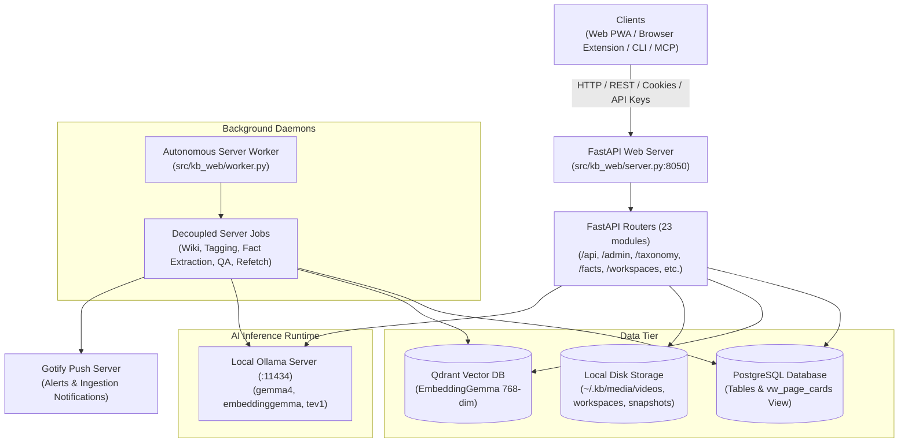
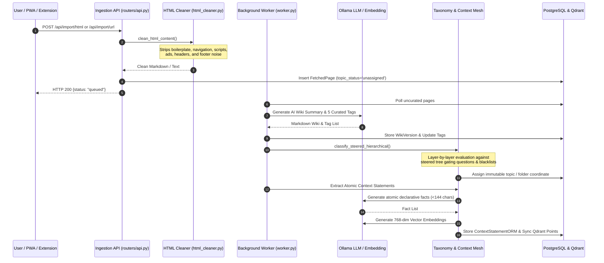

# Architecture Overview

This document details the high-level architecture, subsystem boundaries, data pipelines, deployment topology, and Git release workflows of **`kb-web`**.

---

## 1. System Architecture Topology

The application is structured as a decoupled, multi-tier asynchronous architecture combining a FastAPI web application, persistent PostgreSQL database, Qdrant vector search engine, local Ollama LLM inference runtime, and autonomous background worker daemons.



---

## 2. Ingestion & Curation Lifecycle

Every web article, YouTube video, Git repository, or Markdown note ingested into `kb-web` passes through a multi-stage curation pipeline:



---

## 3. Subsystem Breakdown

### 3.1. Core Runtime & Configuration
- **`src/kb_web/server.py`**: Initializes the FastAPI ASGI application, registers CORS and security middleware, mounts static files, and registers all 23 routers.
- **`src/kb_web/config.py`**: Multi-source configuration loader prioritizing environment variables (`KB_*`), database persistent settings (`SettingExternal`, `SettingOllama`), and local JSON configuration (`~/.kb/configs/kb-web.json`).
- **`src/kb_web/base.py`**: Database session factory (`db_session()`), connection pooling (SQLAlchemy engine), Jinja2 environment configuration with custom filters, and session cookie cryptography (`generate_session_token`, `verify_session_token`).
- **`src/kb_web/models_orm.py`**: Complete declarative SQLAlchemy ORM models mapping tables, relationships, and PostgreSQL indexes.

### 3.2. Steered Knowledge Tree & Topic Governance
- **`src/kb_web/taxonomy/steered_tree.py`**: Manages the user-steered hierarchical taxonomy file-tree (`SteeredTaxonomyNode`). Each node defines:
  - Custom name and path coordinates (`/Folder/Subfolder`).
  - Qualification gating criteria questions passed into decision models.
  - Domain blacklists (e.g. blocking specific domains from a topic).
  - Lifecycle policies (`is_frozen`, `lifecycle_action: "freeze"` vs `"refetch"`, `refetch_interval_hours`).
- **`src/kb_web/taxonomy/engine.py`**: Core taxonomy engine executing layer-by-layer decision classification, atomic bulk relocations (`bulk_move_items`, `bulk_move_facts`), topic deletion with cascade unassignment (`delete_topic_or_subtopic`), and topic editing (`edit_topic`).
- **`src/kb_web/context_mesh/`**: Atomic declarative fact mesh (`ContextStatementORM`). Manages factual statements extracted from content, vector deduplication (`fact_similarity_threshold = 0.85`), character constraints (`max_fact_char_count = 144`), and nested personal value-knowledge context (`personal_vk.py`).

### 3.3. Autonomous Topic Agents & Living Wikis
- **`src/kb_web/custom_agent_engine.py`**: Orchestrates custom autonomous topic specialists (`CustomAgent`). Agents maintain:
  - Working memory observations (`AgentObservation`).
  - Self-directed task queues (`AgentSelfTask`).
  - Living markdown topic wikis (`TopicWikiPage`) with citation links.
  - Dynamic canvas pages (`AgentPage`) supporting themed and raw rendering modes.
- **`src/kb_web/python_kernel.py`**: Human-In-The-Loop (HITL) execution sandbox. Agents proposing Python execution must submit code for human review (`AgentPythonApproval`), blocking execution until explicitly approved by an administrator in the UI.

### 3.4. Agentic RAG & Decision Scoring
- **`src/kb_web/rag_agent.py`**: Multi-sub-agent retrieval engine querying taxonomy tags, vector chunk similarity (`pgvector` / Qdrant), and lexical full-text.
- Integrates native `ollama.systemone` `tev1` multi-question decision gating (up to 64 questions per turn) to evaluate evidence quality and synthesize publication-grade research reports (`/reports/rag`, `kb-web-cli rag report`).

### 3.5. Background Workers & Decoupled Jobs Registry
- **`src/kb_web/worker.py`**: Decoupled async background job scheduler managing independent cron jobs:
  - `wiki_generation`: Generates missing Markdown wikis for ingested articles.
  - `tagging`: Assigns curated tags using Ollama.
  - `topic_assignment`: Categorizes unassigned items into the steered knowledge tree.
  - `fact_extraction`: Extracts atomic declarative context statements.
  - `lifecycle_refetch`: Re-fetches scheduled items and sends Gotify push alerts.
  - `embedding_refresh`: Backfills missing Qdrant / PostgreSQL vector embeddings.
  - `synthetic_qa` & `rag_eval`: Autonomous dataset generation and retrieval evaluation.
- Features dynamic interval scheduling (`interval_minutes`), per-job model selection, execution tracking in `worker_job_executions`, and one-click "Core Only" controls (`POST /api/jobs/pause-non-core`) preserving only wiki and tag curation.

### 3.6. Workspaces & Monaco Python WASM IDE
- **`src/kb_web/routers/workspaces.py`**: Virtual coding workspaces with persistent multi-file file systems.
- Integrates Monaco Editor, Pyodide Python WASM execution directly in the browser, sandboxed iframe previews, and terminal coding assistants (`workspace_agent.py`) paired with file manipulation tools.

---

## 4. Tiered Git Release Lifecycle

The repository enforces a strict 3-tier release architecture ensuring stability across active development and production deployments:

```mermaid
gitGraph
    commit id: "v0.5.15 on master"
    branch production
    checkout production
    commit id: "staging verified"
    branch development
    checkout development
    commit id: "active work"
    branch feature/taxonomy-v2
    checkout feature/taxonomy-v2
    commit id: "implement feature"
    commit id: "add unit tests"
    checkout development
    merge feature/taxonomy-v2 id: "merge feature to dev"
    checkout production
    merge development id: "stage to production"
    checkout master
    merge production id: "cut v0.5.16 on master"
```

1. **`development`**: Primary trunk branch for active day-to-day development. All feature, bugfix, and sprint branches (`feature/...`, `fix/...`) branch off `development` and merge back into `development` via draft pull requests.
2. **`production`**: Pre-release staging branch. Once features, test suites, and UAT pass all pre-commit verification checks (`uv run python build.py`), verified increments are merged from `development` into `production`.
3. **`master`**: Stable production release line. Merged from `production` only when formal release milestones are reached and verified across all automated test suites.

---

## 5. Deployment Topology & System Services

`kb-web` is designed to run on Linux host servers (or Windows development machines) with systemd process supervision:

- **Web Server Service (`kb-web.service`)**:
  - Runs Uvicorn ASGI / Gunicorn server binding to `0.0.0.0:8050`.
  - Managed via `systemctl restart kb-web.service` or remotely via `POST /api/admin/restart` and `kb-web-cli restart`.
- **MCP Server Service (`kb-web-mcp.service`)**:
  - Exposes Model Context Protocol endpoints for external coding agents (Claude Code, Cursor, Antigravity) to query knowledge base articles, search vectors, and execute tools.

