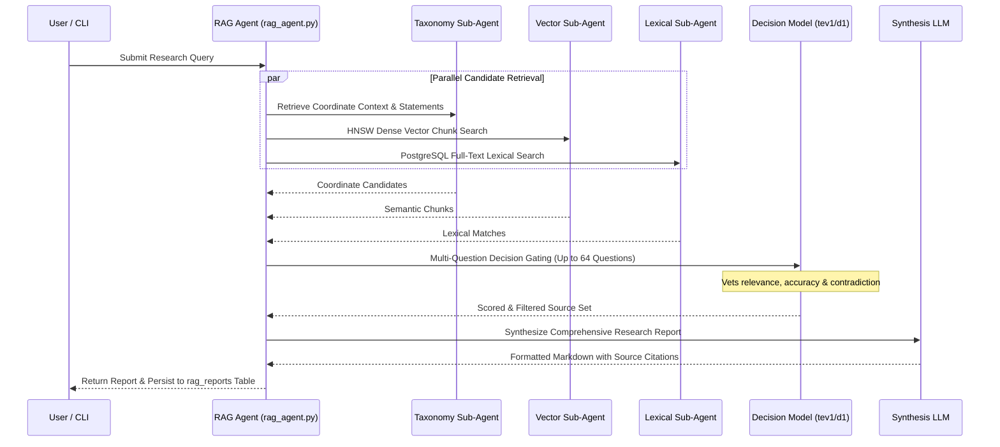

# Subsystem Deep Dive: Agents & RAG Architecture

The Agents & RAG subsystem provides autonomous topic exploration, decision-gated retrieval-augmented generation (RAG), and human-in-the-loop developer tools.

---

## 1. Components & File Layout

| File | Purpose | Key Exports |
|---|---|---|
| `rag_agent.py` | Multi-sub-agent retriever, tev1 decision scoring, report synthesis | `RagReportAgent`, `execute_rag_flow()` |
| `custom_agent_engine.py` | Autonomous topic agent engine, living wiki generation | `CustomAgentEngine`, `run_agent_cycle()` |
| `python_kernel.py` | Strictly gated HITL Python execution environment | `PythonKernel`, `execute_approved_code()` |
| `workspace_agent.py` | In-browser coding assistant inside Monaco Editor workspaces | `WorkspaceAgent`, `generate_code_patch()` |
| `agent_config.py` | Persona configurations, system prompt builders | `AgentConfigManager`, `get_prompt_for_agent()` |
| `agent_memory.py` | Long-term and working memory journal logger | `AgentMemoryJournal`, `record_observation()` |
| `agent_tools.py` | Structured tool definitions and execution dispatch | `execute_tool_call()`, `search_knowledge()` |

---

## 2. Agentic RAG & Decision Scoring Pipeline

### Multi-Question Decision Scoring (`tev1`):
Unlike standard naive RAG which simply concatenates top-K vector matches, `kb-web` employs a decision gating phase:
- Evaluates each candidate chunk against binary gating questions (e.g., "Does this passage directly answer the query without speculation?").
- Filters out hallucinated or distantly related context chunks.
- Ensures the final synthesis prompt receives only high-density, authoritative grounding text.

---

## 3. Autonomous Topic-Expert Agents (`custom_agent_engine.py`)

Topic agents are assigned to specific nodes in the knowledge tree (e.g., `Software Documentation/Python`). When triggered by cron or on-demand:
1. **Coordinate Surveillance**: Detects newly ingested pages or updated context statements within their coordinate scope.
2. **Observation Journaling**: Writes structured observations into `agent_observations`.
3. **Living Topic Wikis**: Authors or incrementally updates multi-page Markdown wikis (`topic_wiki_pages`), organizing knowledge into clean sub-paths (e.g., `/wiki/python-agent/memory-layout`).
4. **Dynamic Canvas Pages**: Renders self-contained interactive dashboards or HTML documents stored in `agent_pages` and viewable at `/pages/agent/{hash_id}`.

---

## 4. Human-In-The-Loop (HITL) Python Kernel (`python_kernel.py`)

To allow agents to execute data analysis, benchmarks, or math calculations safely:
- **Sandbox Environment**: Runs using the project's active `.venv` interpreter in a restricted subprocess.
- **Strict Human Approval Gate**: An agent **cannot** execute arbitrary code directly. It submits a proposal to `agent_python_approvals`.
- **Interactive Review**: The user inspects the proposed Python code in the UI dialog (`/agents` or `/workspaces`).
- **Execution & Audit**: Only upon explicit human click ("Approve & Run") does the kernel execute the code, capturing stdout, stderr, execution duration, and exit code.
- **Security Invariant**: Never bypasses this gate or executes unreviewed agent scripts.

---

## 5. In-Browser Workspace Agent (`workspace_agent.py`)

Powers the AI coding assistant paired inside Monaco Editor workspaces:
- Reads open files and active editor selections.
- Generates standard Git unified diffs or replacement blocks.
- Provides syntax explanation and runs automated tests via Pyodide in-browser WASM without burdening the host machine.

