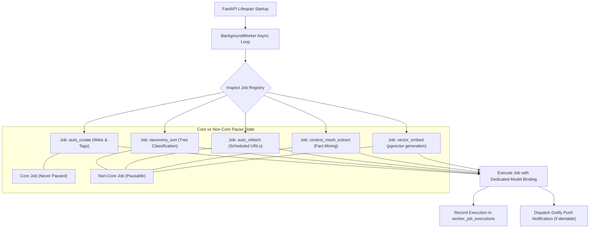

# Subsystem Deep Dive: Background Workers & Job Registry

The Background Workers subsystem manages all asynchronous, recurring, and long-running operations in `kb-web`, including content curation, taxonomy classification, scheduled re-fetches, and notification dispatch.

---

## 1. Components & File Layout

| File | Purpose | Key Exports |
|---|---|---|
| `worker.py` | Asynchronous worker loop, decoupled job registry, pause controls | `BackgroundWorker`, `JobRegistry` |
| `gotify.py` | Real-time push alert dispatcher to Gotify server | `send_gotify_alert()`, `notify_worker_event()` |
| `scripts/check_db_ready.py` | Database connectivity readiness probe | `wait_for_db()` |
| `scripts/deploy_migrations.py` | Database migration runner applying DDL scripts | `apply_migrations()` |

---

## 2. Background Worker Architecture (`worker.py`)

---

## 3. Modular Job Registry

Rather than running an undifferentiated monolithic script, `worker.py` decouples background tasks into an independent **Job Registry**:

### Standard Jobs:
1. `auto_curate`: Identifies pages where `ai_wiki IS NULL` or `tags IS NULL`, generates markdown summaries and curated tags using the configured LLM.
2. `taxonomy_sort`: Evaluates unclassified items (`tax_kingdom IS NULL`) and guides them down the steered knowledge tree layer-by-layer using the decision model.
3. `auto_refetch`: Queries pages where `auto_refetch = TRUE` and `last_refetched_at < NOW() - INTERVAL 'refetch_interval_hours'`, refetches the page, checks ETag/content hash, records changes, and dispatches Gotify alerts.
4. `context_mesh_extract`: Scans recently curated pages to extract atomic facts, invariants, and affordances, condensing them to `<= 144` characters.
5. `vector_embed`: Generates dense 768-dim embeddings for article text, titles, chunks, and context statements.

### Job Configuration Schema:
Each registered job exposes:
- `interval_minutes`: Independent polling cadence (e.g., 5 min for curate, 30 min for taxonomy sort, 60 min for refetch).
- `enabled`: Dynamic boolean toggle persisted in database settings.
- `model_binding`: Dedicated LLM, embedding, or decision model assigned to that specific task.
- `last_run_at` & `next_run_at`: Execution scheduling timers.

---

## 4. "Pause Non-Core" Operations Control

To allow the user to make major structural changes to the taxonomy tree without race conditions with background classifiers, `kb-web` provides a one-click **Pause Non-Core** control (`POST /api/jobs/pause-non-core`):

- **Non-Core Jobs Paused**: `taxonomy_sort`, `context_mesh_extract`, `auto_refetch`, and autonomous agent loops are immediately suspended.
- **Core Jobs Preserved**: Basic URL ingestion, boilerplate cleaning, markdown wiki creation, and tag generation remain active.
- **State Transparency**: Worker UI and Admin Portal prominently display the pause badge and active job counters.

---

## 5. Execution Logging & Gotify Dispatch (`gotify.py`)

- **Audit Trails**: Every job run writes a record to `worker_job_executions` capturing `job_id`, `status` (`running`, `success`, `failed`), `items_processed`, `duration_seconds`, and `error_message`.
- **Gotify Push Notifications**:
  - Pushes real-time alerts on automated refetches that detect content modifications.
  - Warns on consecutive worker failures or Ollama connection timeouts.
  - Can be silenced during testing by unsetting `GOTIFY_URL` or via the global mock in `tests/test_server.py`.

