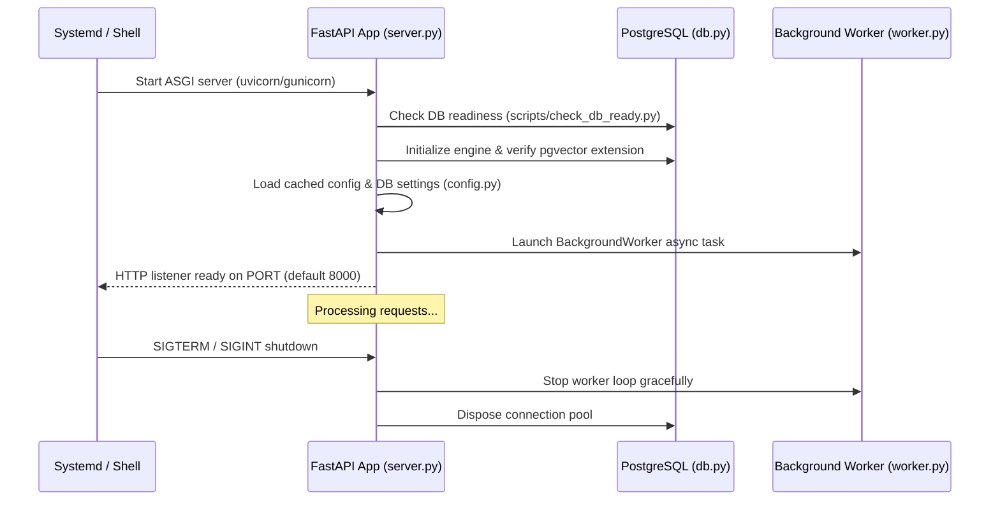

# Subsystem Deep Dive: Core Runtime

The Core Runtime subsystem provides the foundational infrastructure for `kb-web`, including the FastAPI application lifecycle, dynamic configuration management, PostgreSQL connection pooling, and shared utilities.

---

## 1. Components & File Layout

| File | Purpose | Key Exports |
|---|---|---|
| `server.py` | FastAPI app setup, middleware, lifespan handlers | `create_app()`, `lifespan()` |
| `config.py` | Hierarchical configuration, DB settings override | `Settings`, `get_settings()` |
| `base.py` | Database session factory, base models, action logger | `get_db_session()`, `log_action()` |
| `db.py` | Engine initialization, pgvector support | `get_engine()`, `init_db()` |
| `models_orm.py` | Declarative SQLAlchemy ORM models | 50 ORM entities |
| `models.py` | Pydantic request/response validation schemas | 17 Pydantic schemas |
| `utils.py` | Text normalization, hashing, domain parsing | Text & URL utilities |
| `gunicorn_runner.py` | Multi-worker WSGI/ASGI wrapper | `run_gunicorn()` |

---

## 2. Application Lifecycle & Startup Flow



### Key Responsibilities in `server.py`:
1. **Lifespan Management**: `async def lifespan(app: FastAPI)` launches the background worker loop on startup and terminates it cleanly on shutdown.
2. **Security Headers & Middleware**:
   - Brute-force rate limiting on `/login`.
   - Session cookie authentication using secure HMAC-signed tokens.
   - ZipSlip path validation for workspace file extractions.
   - CORS policy configuration.
3. **Router Mounting**: Registers all 23 modular router modules under explicit prefixes (`/admin`, `/api`, `/taxonomy`, `/workspaces`, etc.).

---

## 3. Dynamic Configuration Architecture (`config.py`)

Configuration values in `kb-web` adhere to a **Strict Configuration Transparency** rule: no hidden arbitrary constants. Configuration resolves through a 3-tier hierarchy:

1. **Environment Variables / `.env`**: Static fallbacks (e.g. `DATABASE_URL`, `SECRET_KEY`, `OLLAMA_URL`).
2. **Database Settings (`setting_ollama`, `setting_external`)**: Dynamic parameters configured through the Admin Portal (`/admin/settings`).
3. **In-Memory TTL Cache**: In-memory cache invalidated every 60 seconds (or immediately on admin updates) to prevent per-request database overhead.

### Essential Config Parameters:
- `DEFAULT_LLM_MODEL`: Primary LLM for summarization and tagging (e.g., `gemma2:9b`).
- `DEFAULT_EMBED_MODEL`: Model used for vector embeddings (e.g., `embeddinggemma:latest`).
- `DEFAULT_DECISION_MODEL`: Specialized model for taxonomy gating & scoring (e.g., `d1:latest` or `tev1`).
- `MAX_FACT_CHAR_COUNT`: Strict character limit for atomic facts (default `144`).
- `FACT_SIMILARITY_THRESHOLD`: Cosine cutoff for deduplicating context statements (default `0.85`).
- `AUTO_CURATE_INTERVAL_MINUTES`: Frequency of worker auto-curation loops.

---

## 4. Database Session & Engine Pool (`db.py`, `base.py`)

- **Connection Pool**: Uses SQLAlchemy's `QueuePool` with configurable `pool_size=10` and `max_overflow=20`.
- **Session Lifecycle**: Database sessions are provided via standard context manager / FastAPI dependency injection:
  ```python
  def get_db():
      session = SessionLocal()
      try:
          yield session
      finally:
          session.close()
  ```
- **pgvector Vector Integration**: `SafeVector` comparator allows queries to execute seamlessly across environments, whether running against live PostgreSQL `pgvector` or mocked unit test harnesses.

---

## 5. Text Normalization & Hashing (`utils.py`)

- `hash_sha256(text: str) -> str`: Produces 64-character hexadecimal digest used for content-based deduplication and version tracking.
- `extract_domain(url: str) -> str`: Normalizes URLs to lowercase domain names (stripping `www.`, ports, and protocol).
- `sanitize_title(title: str) -> str`: Cleans raw page titles, stripping pipe separators and site suffixes.

