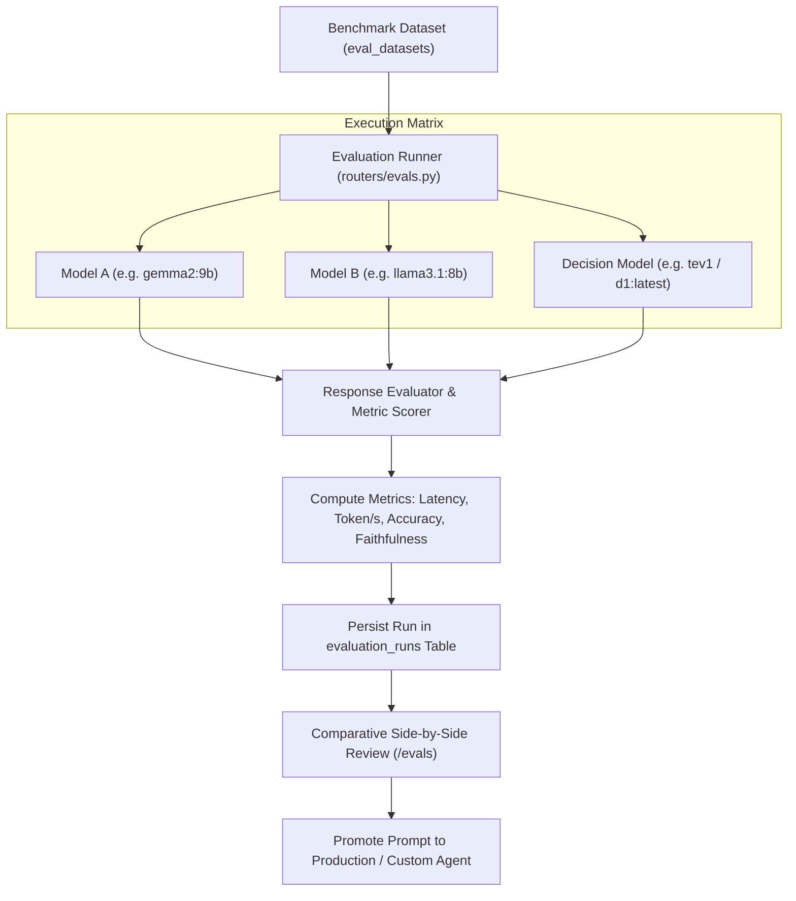

# Subsystem Deep Dive: Model Evaluation Studio (`/evals`)

The Model Evaluation Studio (`/evals`) provides an interactive benchmarking and calibration portal for comparing LLMs, fine-tuning decision models (`d1`/`tev1`), and promoting verified system prompts into production.

---

## 1. Components & File Layout

| File | Purpose | Key Exports |
|---|---|---|
| `routers/evals.py` | Evaluation portal endpoints, run executor, side-by-side comparator | 24 route handlers |
| `models_orm.py` | Evaluation run and dataset entities (`evaluation_runs`, `eval_datasets`)| `EvaluationRun`, `EvalDataset` |
| `templates/evals.html` | Interactive evaluation UI with comparative tables and metric charts | Evaluation dashboard |

---

## 2. Evaluation Studio Architecture

---

## 3. Comparative Matrix & Benchmark Runs

Users can execute standardized test runs across multiple Ollama models simultaneously:
1. **Dataset Selection**: Select an existing dataset of questions, ground truth answers, and reference context chunks, or create custom test suites.
2. **Matrix Parameters**:
   - Model candidates (e.g., `gemma2:9b`, `mistral-nemo`, `qwen2.5:14b`).
   - Generation parameters: temperature, context window (e.g. 16k tokens), top-p, repeat penalty.
   - System prompts under test.
3. **Execution & Metrics**:
   - **Generation Latency**: First-token latency (TTFT) and throughput (tokens/second).
   - **Accuracy & Grounding**: LLM-as-a-judge scoring comparing outputs against reference facts.
   - **JSON / Tool Calling Reliability**: Strict format compliance verification.

---

## 4. Decision Model Calibration (`d1` / `tev1`)

The Studio includes dedicated workflows for calibrating decision gating models:
- Tests the decision model's ability to answer up to 64 binary gating questions per turn.
- Evaluates classification precision across complex taxonomy trees.
- Validates blacklist enforcement and edge-case handling before deploying models to the background worker.

---

## 5. Prompt Promotion Workflow

Once a prompt achieves superior benchmark scores in the Evaluation Studio:
- **One-Click Promotion**: The user clicks "Promote Prompt" in the UI.
- **Target Selection**:
  - Promote to **Server Instruction** (updating the system-wide curation prompt in `SettingOllama`).
  - Promote to **Custom Topic Agent** (updating `custom_agents.system_prompt`).
- **Audit History**: Historical revisions are logged in `wiki_versions` or `agent_prompts` to ensure complete traceability.

