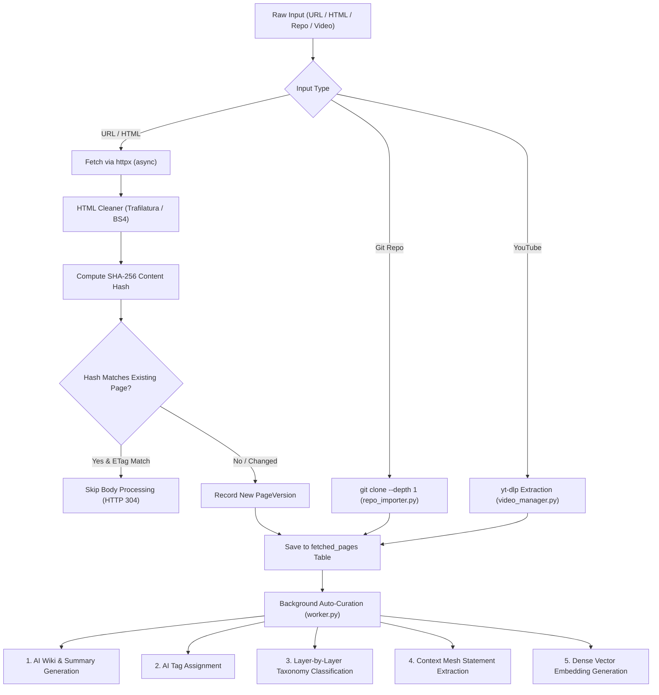

# Subsystem Deep Dive: Ingestion Pipelines

The Ingestion Pipelines subsystem is responsible for transforming raw external resources (HTML web pages, remote Git repositories, YouTube videos, and site hierarchies) into clean, versioned, semantic markdown knowledge.

---

## 1. Components & File Layout

| File | Purpose | Key Exports |
|---|---|---|
| `pipeline.py` | Central ingestion orchestrator, version capture, AI wiki trigger | `run_ingestion_pipeline()`, `reprocess_page()` |
| `html_cleaner.py` | Boilerplate removal and Markdown conversion via Trafilatura | `clean_html_to_markdown()`, `extract_title_and_meta()` |
| `crawler.py` | Recursive link and sitemap crawler with domain boundaries | `crawl_domain()`, `extract_sitemap_urls()` |
| `repo_importer.py` | Remote Git repository cloner, AST scanner, tree generator | `clone_and_index_repo()`, `generate_tree_markdown()` |
| `video_manager.py` | Subprocess wrapper for `yt-dlp` YouTube metadata & transcripts | `fetch_youtube_metadata()`, `extract_transcript()` |

---

## 2. Ingestion Pipeline Execution Flow

---

## 3. Web Page Cleaning & Distillation (`html_cleaner.py`)

- **Primary Cleaner**: Employs `trafilatura` for state-of-the-art article body extraction, removing navigation bars, ads, comment sections, and footers.
- **Fallback**: BeautifulSoup4 DOM tree parser with selective tag pruning (`script`, `style`, `nav`, `header`, `footer`, `aside`, `iframe`).
- **Metadata Extraction**:
  - OpenGraph title (`og:title`), Twitter card title, or `<title>`.
  - OpenGraph description (`og:description`) and author tags.
  - Canonical URL link resolution.
- **Markdown Conversion**: Formats headings, tables, blockquotes, and fenced code blocks cleanly to ensure high fidelity for LLM consumption.

---

## 4. Git Repository Ingestion (`repo_importer.py`)

Ingests public and private (token-authenticated) Git repositories directly from the web UI (`/import` Tab 3) or API (`POST /api/import/repo`):

1. **Sandboxed Clone**: Executes `git clone --depth 1 --single-branch` into a transient temporary folder.
2. **Directory Tree Generation**: Builds a complete markdown visualization of the repository file hierarchy, ignoring `.git/`, binary files, node modules, and virtual environments.
3. **Source Code Extraction**: Reads high-value source files (`.py`, `.ts`, `.js`, `.go`, `.rs`, `README.md`, etc.), extracting class/function definitions and module docstrings.
4. **Knowledge Base Storage**: Stores the repository overview as a root article in `fetched_pages`, and individual critical files as subordinate linked pages.

---

## 5. YouTube Media Pipeline (`video_manager.py`)

- **Subprocess Invocation**: Executes `yt-dlp` in non-blocking threads to fetch JSON metadata without downloading the full video binary.
- **Transcript Extraction**:
  - Attempts download of human-authored English subtitles (`.vtt` or `.srt`).
  - Falls back to auto-generated subtitles (`--write-auto-sub`).
  - Cleans timestamp tags into sequential, readable markdown paragraphs.
- **AI Synthesis**: Passes transcript chunks to Ollama to produce a structured video outline with key takeaways, timestamps, and quotes.

---

## 6. Recursive Crawler (`crawler.py`)

- **Domain Boundaries**: Strictly confined to the target hostname to prevent open-web crawling loops.
- **Concurrency & Rate Limiting**: Employs `asyncio.Semaphore` with configurable request jitter (default 200ms–500ms).
- **Robots.txt & Sitemap**: Automatically inspects `/robots.txt` and queries standard `/sitemap.xml` endpoints before initiating link discovery.

