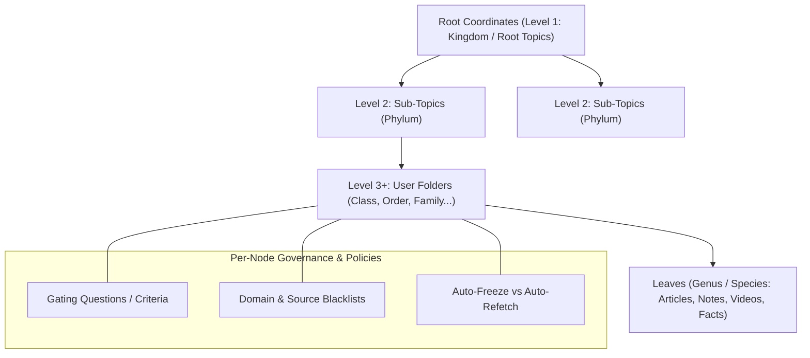

# Subsystem Deep Dive: Steered Knowledge Tree & Context Mesh

The Steered Knowledge Tree & Context Mesh subsystem provides structured knowledge grounding for `kb-web`. It moves beyond rigid biological taxonomy into a dynamic, user-steered folder graph accompanied by an atomic fact mesh.

---

## 1. Components & File Layout

| File | Purpose | Key Exports |
|---|---|---|
| `taxonomy/engine.py` | Layer-by-layer classification, gating evaluation, blacklist enforcement | `TaxonomyEngine`, `classify_item_by_layer()` |
| `taxonomy/steered_tree.py` | In-memory & DB tree graph manager, node CRUD, bulk relocations | `SteeredTaxonomyTree`, `add_node()`, `delete_node()` |
| `taxonomy/models.py` | Pydantic validation schemas for tree nodes, criteria, and moves | `SteeredTaxonomyNode`, `BulkMoveRequest` |
| `context_mesh/pipeline.py` | LLM-driven atomic statement extraction (fact, intent, invariant, affordance) | `ContextMeshPipeline`, `extract_statements()` |
| `context_mesh/store.py` | Statement persistence, vector similarity deduplication | `ContextMeshStore`, `insert_statement()` |
| `context_mesh/retriever.py` | Coordinate-aware and vector-semantic fact retrieval | `ContextMeshRetriever`, `search_facts()` |
| `context_mesh/personal_vk.py` | User-curated Personal Value-Knowledge (VK) JSON loader & injector | `PersonalVKManager`, `inject_vk()` |

---

## 2. Dynamic Knowledge Tree Architecture



### Key Principles:
1. **User-Steered Primacy**: The user defines the top-level topics and nested folder nodes. AI agents are **strictly constrained** to classify items within the existing allowed tree hierarchy.
2. **Layer-by-Layer Decision Gating**:
   - Rather than presenting a model with hundreds of potential paths at once, classification proceeds one layer at a time.
   - The decision model (`d1:latest` or `tev1`) receives the current node's immediate children, along with each child's natural language `gating_criteria`.
   - The decision model evaluates which child best satisfies the item's content.
   - If no child meets the criteria, the item remains at the parent or falls back to `Unclassified`.
3. **Domain Blacklists**: Each node can define a `domain_blacklist` JSON array. Any item matching a blacklisted domain is strictly forbidden from being assigned to that node or its descendants.
4. **Content Lifecycle Controls**:
   - `is_frozen`: Items placed in this node are protected from worker re-classification.
   - `auto_refetch`: Items placed in this node inherit automated background polling (default 168 hours) with real-time Gotify push alerts upon updates.
5. **Bulk Relocations**: The user can move large volumes of articles, notes, videos, and context statements between folder coordinates via `POST /api/taxonomy/items/bulk-move` and `POST /api/taxonomy/facts/bulk-move`.

---

## 3. Atomic Context Mesh (`context_mesh/`)

While articles contain thousands of words, reasoning agents require atomic, high-precision propositions. The Context Mesh distills every article into verified micro-statements.

### Statement Types:
- `fact`: Concrete objective truth (e.g., "PostgreSQL 15 supports pgvector HNSW indexing").
- `intent`: The author's stated objective or design goal.
- `invariant`: A rule or constraint that must never be violated.
- `affordance`: An action, API, or capability exposed by a tool or library.

### Precision Safeguards:
1. **Length Condensation**: Statements are strictly truncated or LLM-condensed to `<= 144` characters (`MAX_FACT_CHAR_COUNT`).
2. **Vector Similarity Deduplication**: When a new statement is extracted, its embedding is compared against existing statements in that node using cosine distance. If similarity exceeds `0.85` (`FACT_SIMILARITY_THRESHOLD`), the redundant statement is discarded.
3. **Automatic Purge on Rejection**: Denying or deleting a topic node automatically purges or re-queues associated context statements.

---

## 4. Personal Value-Knowledge (VK) Layer (`personal_vk.py`)

The user's nested Personal VK JSON represents personal preferences, domain values, and persistent perspectives:

```json
{
  "development_values": {
    "architecture": "Monorepo, vertical slices, strict type safety",
    "databases": "PostgreSQL unified, zero arbitrary SQLite fallbacks",
    "ui_standards": "Clean professional descriptive labels, zero developer jargon"
  },
  "research_focus": [
    "High-throughput vector search",
    "Agentic RAG decision gating"
  ]
}
```

The `PersonalVKManager` loads this JSON from database settings and injects it as an immutable system prompt layer into all autonomous agents, ensuring agent research and reasoning align with the user's worldview.

